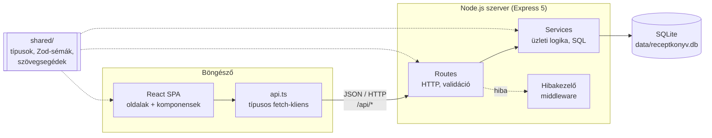
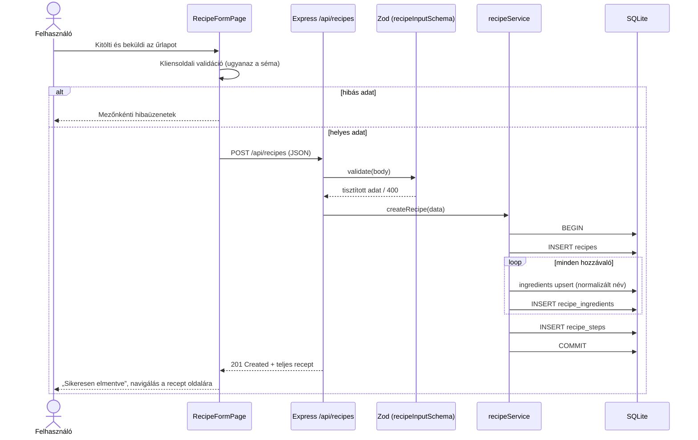

# Rendszerarchitektúra

## 1. Áttekintés

Klasszikus háromrétegű, kliens–szerver felépítés: egy React SPA (single-page application) REST API-n keresztül kommunikál egy Express szerverrel, amely egy helyi SQLite-adatbázisban tárolja az adatokat.



### Rétegek és felelősségek

| Réteg | Hely | Felelősség |
| --- | --- | --- |
| Megjelenítés | `client/src/pages`, `client/src/components` | Oldalak, UI-komponensek, felhasználói interakciók, állapotok (betöltés, hiba, üres) |
| Kliens-adatelérés | `client/src/lib/api.ts`, `hooks/useAsync.ts` | Típusos API-hívások, `ApiError`, betöltési állapot, versenyhelyzetek kezelése |
| HTTP / útvonalak | `server/src/routes` | Paraméterek feldolgozása, Zod-validáció, státuszkódok |
| Üzleti logika | `server/src/services` | Receptek, keresés, kedvencek, bevásárlólista-összevonás, statisztika |
| Adatbázis | `server/src/db` | Séma, kapcsolat, tranzakciók, seed |
| Közös kód | `shared/` | Típusok (`types.ts`), validációs sémák (`schemas.ts`), normalizálás (`text.ts`) |

**Fontos tervezési döntés:** a `shared/schemas.ts` Zod-sémáit a frontend (űrlapvalidáció) és a backend (kérésvalidáció) is használja. Így a szabályok egy helyen vannak, a kliens és a szerver nem térhet el egymástól, és a hibaüzenetek mindkét oldalon azonosak.

## 2. Frontend és backend kapcsolata

- **Fejlesztői mód** (`npm run dev`): a `concurrently` két folyamatot indít. A Vite dev szerver (5173) kiszolgálja a frontendet, és a `/api` kéréseket proxyn továbbítja az Express szervernek (3001). A böngésző szemszögéből minden ugyanarról az originről érkezik, ezért nincs CORS-probléma.
- **Éles mód** (`npm run build` + `npm start`): a Vite a `dist/client` mappába fordít, az Express pedig statikusan kiszolgálja. Ismeretlen, nem `/api` útvonalra az `index.html`-t adja vissza (SPA-fallback, így a React Router útvonalai közvetlenül is megnyithatók).
- **Kommunikáció:** JSON a HTTP felett. Sikeres válasz esetén a `shared/types.ts` típusai, hiba esetén egységes hibaobjektum:

```json
{
  "error": {
    "code": "VALIDATION_ERROR",
    "message": "Érvénytelen adatok.",
    "details": [{ "path": "ingredients.0.quantity", "message": "A mennyiségnek nullánál nagyobbnak kell lennie." }]
  }
}
```

A frontend a `details[].path` alapján a hibát pontosan a hibás mezőhöz rendeli.

## 3. Adatfolyamok

### 3.1 Recept mentése



### 3.2 Hozzávalók a bevásárlólistára (összevonással)

1. `POST /api/shopping-list/from-recipe/:id` és opcionálisan `{ servings }`.
2. A szerver betölti a receptet, és ha a kért adagszám eltér, arányosan átszámítja a mennyiségeket (`scaleQuantity`).
3. Egyetlen tranzakcióban minden hozzávalóra lefut az `addOrMergeItem`:
   - kulcs: `normalizeKey(név)` (kisbetű, szóközök egységesítve) és `normalizeUnit(egység)` (pl. „gramm” → „g”);
   - ha van **nem kipipált** tétel ugyanezzel a kulccsal **és** egységgel, és mindkettőnek van mennyisége (vagy egyiknek sincs), akkor `UPDATE quantity = régi + új`;
   - különben `INSERT` új sorként.
4. Válasz: `{ added, merged, items }`. A frontend ebből jeleníti meg az értesítést.

**Miért nincs átváltás g és kg között?** A feladat tiltja a különböző mértékegységek hibás összeadását. Az átváltás nélküli, biztonságos szabály mindig helyes eredményt ad, és könnyen ellenőrizhető.

### 3.3 Keresés

A frontend a szűrőket az URL query-paramétereiben tartja (`useSearchParams`). A szövegmezők 300 ms-os késleltetéssel (`useDebounced`) frissülnek. A `useAsync` hook csak a legutolsó kérés eredményét jeleníti meg, így a gyors gépelésből adódó versenyhelyzet nem okoz hibás listát. A szerver dinamikusan, paraméterezett SQL-lel építi fel a `WHERE` feltételt. Az ékezetfüggetlenséget az előre kiszámolt `search_title`, `search_description` és `search_name` oszlopok biztosítják (kisbetűs, ékezet nélküli szöveg).

## 4. REST API-végpontok

Alap-URL: `/api`. Minden kérés- és választörzs JSON.

### Általános

| Metódus | Útvonal | Leírás | Válasz |
| --- | --- | --- | --- |
| GET | `/health` | Életjel | `200 { status: "ok" }` |
| GET | `/stats` | Összesítő: receptek, kedvencek, kategóriák, nyitott listatételek száma | `200 Stats` |

### Receptek

| Metódus | Útvonal | Leírás | Válasz |
| --- | --- | --- | --- |
| GET | `/recipes` | Lista szűréssel (lásd lent) | `200 RecipeSummary[]` |
| GET | `/recipes/:id` | Részletek hozzávalókkal és lépésekkel | `200 Recipe` / `404` |
| POST | `/recipes` | Új recept | `201 Recipe` / `400` |
| PUT | `/recipes/:id` | Teljes módosítás | `200 Recipe` / `400` / `404` |
| DELETE | `/recipes/:id` | Törlés (kaszkádolt) | `204` / `404` |
| GET | `/ingredients` | Ismert hozzávalónevek (automatikus kiegészítéshez) | `200 string[]` |

`GET /recipes` query-paraméterei (mind opcionális, együtt kombinálhatók):

| Paraméter | Példa | Jelentés |
| --- | --- | --- |
| `q` | `gulyas` | Név vagy leírás tartalmazza (ékezet- és kisbetű-független) |
| `ingredient` | `tojás, tej` | Minden felsorolt hozzávalót tartalmazza |
| `category` | `levesek` | Kategória slug |
| `maxTime` | `30` | Elkészítési idő legfeljebb ennyi perc |
| `difficulty` | `konnyu` / `kozepes` / `nehez` | Nehézségi szint |
| `sort` | `name` / `time` / `newest` | Rendezési szempont (alapértelmezés: `name`) |
| `order` | `asc` / `desc` | Irány |
| `favorites` | `true` | Csak kedvencek |
| `featured` | `true` | Csak kiemeltek |
| `limit` | `6` | Legfeljebb ennyi találat (1–100) |

Példa recepttörzs (`POST` és `PUT`):

```json
{
  "title": "Túrós csusza",
  "description": "Széles metélt túróval és tejföllel.",
  "categoryId": 3,
  "prepTimeMinutes": 30,
  "servings": 4,
  "difficulty": "konnyu",
  "imageUrl": null,
  "isFeatured": false,
  "ingredients": [
    { "name": "széles metélt", "quantity": 400, "unit": "g" },
    { "name": "só", "quantity": null, "unit": "" }
  ],
  "steps": ["Kifőzzük a tésztát.", "Összeforgatjuk a túróval."]
}
```

### Kategóriák

| Metódus | Útvonal | Leírás | Válasz |
| --- | --- | --- | --- |
| GET | `/categories` | Kategóriák receptszámmal | `200 Category[]` |
| POST | `/categories` | Új kategória `{ name, icon? }` | `201` / `400` / `409` (már létezik) |
| DELETE | `/categories/:id` | Törlés, csak ha nincs hozzá recept | `204` / `404` / `409` |

### Kedvencek

| Metódus | Útvonal | Leírás | Válasz |
| --- | --- | --- | --- |
| GET | `/favorites` | Kedvenc receptek | `200 RecipeSummary[]` |
| PUT | `/favorites/:recipeId` | Kedvencnek jelölés (idempotens) | `200 { recipeId, isFavorite: true }` / `404` |
| DELETE | `/favorites/:recipeId` | Eltávolítás | `200 { recipeId, isFavorite: false }` / `404` |

### Bevásárlólista

| Metódus | Útvonal | Leírás | Válasz |
| --- | --- | --- | --- |
| GET | `/shopping-list` | Tételek (nem kipipáltak elöl) | `200 ShoppingListItem[]` |
| POST | `/shopping-list` | Kézi tétel `{ name, quantity?, unit? }`, összevonással | `201 { item, merged: false }` / `200 { item, merged: true }` / `400` |
| POST | `/shopping-list/from-recipe/:recipeId` | Recept hozzávalói `{ servings? }` | `200 { recipeId, added, merged, items }` / `404` |
| PATCH | `/shopping-list/:id` | Részleges módosítás `{ name?, quantity?, unit?, isChecked? }` | `200` / `400` / `404` |
| DELETE | `/shopping-list/:id` | Tétel törlése | `204` / `404` |
| DELETE | `/shopping-list/checked` | Kipipált tételek törlése | `200 { deleted }` |
| DELETE | `/shopping-list` | Teljes lista kiürítése | `200 { deleted }` |

### HTTP-státuszkódok és hibakódok

| Státusz | `error.code` | Mikor |
| --- | --- | --- |
| 400 | `VALIDATION_ERROR` | Érvénytelen törzs, query vagy azonosító |
| 400 | `INVALID_JSON` | A törzs nem érvényes JSON |
| 404 | `NOT_FOUND` | Nem létező erőforrás vagy végpont |
| 409 | `CONFLICT` | Foglalt kategórianév, használatban lévő kategória törlése |
| 413 | `PAYLOAD_TOO_LARGE` | Túl nagy kérés (pl. kép > 6 MB) |
| 500 | `INTERNAL_ERROR` | Váratlan szerverhiba (a részletek csak a szerver naplójában) |

## 5. Frontend felépítése

| Útvonal | Oldal | Fő funkciók |
| --- | --- | --- |
| `/` | `HomePage` | Hero kereső, statisztika, kategóriák, kiemelt receptek |
| `/receptek` | `RecipesPage` | Keresés, szűrők, rendezés (URL-ben tárolva) |
| `/receptek/uj` | `RecipeFormPage` | Új recept |
| `/receptek/:id` | `RecipeDetailPage` | Részletek, adagszám-kalkulátor, kedvenc, bevásárlólista, szerkesztés, törlés |
| `/receptek/:id/szerkesztes` | `RecipeFormPage` | Szerkesztés |
| `/kedvencek` | `FavoritesPage` | Kedvencek |
| `/bevasarlolista` | `ShoppingListPage` | Lista kezelése |
| `*` | `NotFoundPage` | 404 |

**Globális állapot:** a `ToastProvider` kezeli az értesítéseket, az `AppDataProvider` pedig az összesítő számokat (fejléc-jelvények), amelyeket a módosító műveletek `refreshStats()`-szal frissítenek. Ennél több globális állapotra nincs szükség, ezért nem használunk Redux-szerű könyvtárat (egyszerűség, kevesebb függőség).

**Optimista frissítés:** a kedvenc-jelölés és a kipipálás azonnal megjelenik a felületen. Ha az API-hívás sikertelen, a felület visszaáll, és hibaértesítést mutat.
