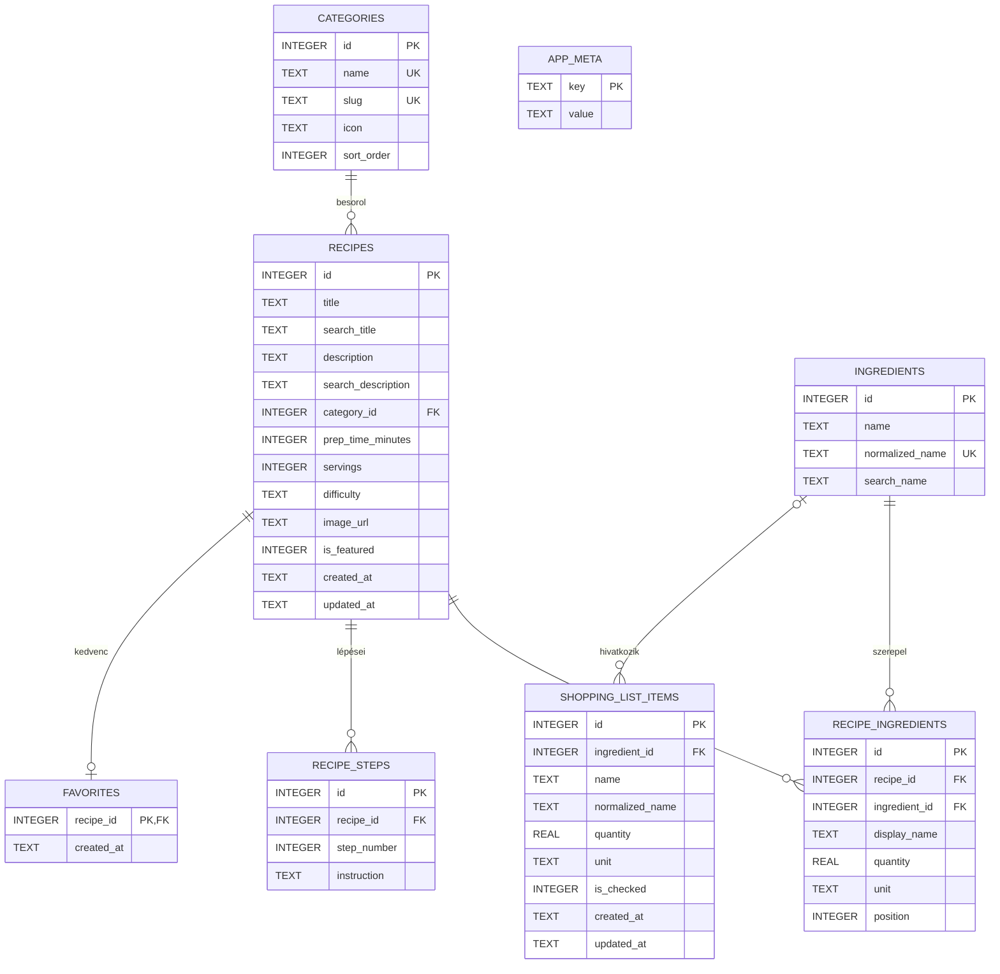

# Adatbázis

## 1. Technológia

- **SQLite**, a Node.js beépített `node:sqlite` moduljával (`DatabaseSync`). Nincs külön adatbázis-szerver, az egész adatbázis egyetlen fájl: `data/receptkonyv.db`.
- `PRAGMA foreign_keys = ON`: az idegen kulcsokat az SQLite ténylegesen ellenőrzi.
- `PRAGMA journal_mode = WAL`: jobb konkurens olvasás és tartós írás. Emiatt a fájl mellett `-wal` és `-shm` fájlok is megjelennek.
- A séma (`server/src/db/schema.ts`) `CREATE TABLE IF NOT EXISTS` utasításokból áll, és minden indításkor biztonságosan lefut.
- A többlépéses műveletek (recept létrehozása és módosítása, recept hozzáadása a listához, seed) **tranzakcióban** futnak (`transaction()` segédfüggvény): hiba esetén minden változás visszavonódik.

## 2. Adatmodell

A modell a receptet és a hozzávalót külön entitásként kezeli, a kettő között **N:M kapcsolat** van a `recipe_ingredients` kapcsolótáblán keresztül. A kapcsolótábla tárolja a recept-specifikus adatokat (mennyiség, mértékegység, sorrend).

## 3. Táblák

### `categories` – receptkategóriák
| Oszlop | Típus | Megszorítás | Leírás |
| --- | --- | --- | --- |
| id | INTEGER | PK, AUTOINCREMENT | Azonosító |
| name | TEXT | NOT NULL, UNIQUE | Megjelenített név (pl. „Főételek”) |
| slug | TEXT | NOT NULL, UNIQUE | URL-barát azonosító (pl. `foetelek`) |
| icon | TEXT | NOT NULL | Lucide ikon neve |
| sort_order | INTEGER | NOT NULL | Megjelenítési sorrend |

### `recipes` – receptek
| Oszlop | Típus | Megszorítás | Leírás |
| --- | --- | --- | --- |
| id | INTEGER | PK | Egyedi azonosító |
| title | TEXT | NOT NULL | Recept neve |
| search_title | TEXT | NOT NULL, index | Kisbetűs, ékezet nélküli név a kereséshez |
| description | TEXT | NOT NULL, alapérték: '' | Rövid leírás |
| search_description | TEXT | NOT NULL | Kereshető leírás |
| category_id | INTEGER | NOT NULL, FK → categories(id), ON DELETE RESTRICT | Kategória |
| prep_time_minutes | INTEGER | NOT NULL, CHECK > 0 | Elkészítési idő (perc) |
| servings | INTEGER | NOT NULL, CHECK > 0 | Adagok száma |
| difficulty | TEXT | CHECK IN ('konnyu','kozepes','nehez') | Nehézségi szint |
| image_url | TEXT | NULL | Kép URL-je vagy `data:image/...` adat-URL |
| is_featured | INTEGER | CHECK IN (0,1) | Kiemelt-e a főoldalon |
| created_at | TEXT | NOT NULL | Létrehozás (ISO 8601) |
| updated_at | TEXT | NOT NULL | Utolsó módosítás (ISO 8601) |

### `ingredients` – hozzávaló-törzs
| Oszlop | Típus | Megszorítás | Leírás |
| --- | --- | --- | --- |
| id | INTEGER | PK | Azonosító |
| name | TEXT | NOT NULL | Név az első előfordulás írásmódjával |
| normalized_name | TEXT | NOT NULL, UNIQUE | Azonosító kulcs: kisbetűs, egységesített szóközök („Tojás ” = „tojás”) |
| search_name | TEXT | NOT NULL | Ékezet nélküli keresőszöveg |

Minden hozzávaló egyszer szerepel. Ha két recept ugyanazt a hozzávalót használja, mindkettő ugyanarra a rekordra hivatkozik. Ez teszi lehetővé a hozzávaló szerinti keresést és a névjavaslatokat.

### `recipe_ingredients` – recept és hozzávaló kapcsolótábla
| Oszlop | Típus | Megszorítás | Leírás |
| --- | --- | --- | --- |
| id | INTEGER | PK | Azonosító |
| recipe_id | INTEGER | NOT NULL, FK → recipes(id), **ON DELETE CASCADE** | Recept |
| ingredient_id | INTEGER | NOT NULL, FK → ingredients(id), ON DELETE RESTRICT | Hozzávaló |
| display_name | TEXT | NOT NULL | A receptben megjelenő név, a felhasználó által beírt írásmóddal |
| quantity | REAL | NULL vagy > 0 | Mennyiség; NULL = „ízlés szerint” |
| unit | TEXT | NOT NULL | Egységesített mértékegység (pl. `g`, `db`, `ek`) |
| position | INTEGER | NOT NULL | Sorrend a receptben |

### `recipe_steps` – elkészítési lépések
| Oszlop | Típus | Megszorítás | Leírás |
| --- | --- | --- | --- |
| id | INTEGER | PK | Azonosító |
| recipe_id | INTEGER | NOT NULL, FK → recipes(id), ON DELETE CASCADE | Recept |
| step_number | INTEGER | NOT NULL, CHECK > 0 | Sorszám (1-től) |
| instruction | TEXT | NOT NULL | Lépés szövege |
| | | UNIQUE (recipe_id, step_number) | Egy receptben minden sorszám egyedi |

### `favorites` – kedvencek
| Oszlop | Típus | Megszorítás | Leírás |
| --- | --- | --- | --- |
| recipe_id | INTEGER | PK, FK → recipes(id), ON DELETE CASCADE | Kedvenc recept |
| created_at | TEXT | NOT NULL | Megjelölés ideje |

Mivel az alkalmazás egyfelhasználós, a `recipe_id` egyben elsődleges kulcs: egy recept vagy kedvenc, vagy nem. A duplikáció adatbázisszinten kizárt.

### `shopping_list_items` – bevásárlólista
| Oszlop | Típus | Megszorítás | Leírás |
| --- | --- | --- | --- |
| id | INTEGER | PK | Azonosító |
| ingredient_id | INTEGER | FK → ingredients(id), ON DELETE SET NULL | Kapcsolódó hozzávaló |
| name | TEXT | NOT NULL | Tétel neve |
| normalized_name | TEXT | NOT NULL | Összevonási kulcs |
| quantity | REAL | NULL vagy > 0 | Mennyiség |
| unit | TEXT | NOT NULL | Egységesített mértékegység |
| is_checked | INTEGER | CHECK IN (0,1) | Megvásárolva |
| created_at, updated_at | TEXT | NOT NULL | Időbélyegek |

Index: `(normalized_name, unit, is_checked)`, ez gyorsítja az összevonáskor futó keresést. A lista tételei szándékosan **nem** hivatkoznak a receptre: ha a receptet törlik, a bevásárlólista érintetlen marad.

### `app_meta` – technikai adatok
Kulcs–érték tábla. Jelenleg a `seed_version` kulcsot tárolja, amely jelzi, hogy a mintaadatok már betöltődtek.

## 4. Kapcsolatok összefoglalása

| Kapcsolat | Számosság | Törlési viselkedés |
| --- | --- | --- |
| categories → recipes | 1 : N | RESTRICT: használt kategória nem törölhető (API: 409) |
| recipes ↔ ingredients (recipe_ingredients) | N : M | Recept törlésekor a kapcsolósorok törlődnek (CASCADE) |
| recipes → recipe_steps | 1 : N | CASCADE |
| recipes → favorites | 1 : 0..1 | CASCADE |
| ingredients → shopping_list_items | 1 : N (opcionális) | SET NULL |

## 5. Normalizálás és tervezési döntések

- **3NF közeli modell:** a hozzávalók neve egyszer tárolódik (`ingredients`), a recept-specifikus adatok a kapcsolótáblában vannak. A `display_name` és a `search_*` oszlopok **tudatos, ellenőrzött redundanciák**: a megjelenítést és a gyors, ékezetfüggetlen keresést szolgálják, és minden íráskor a szerver számolja ki őket.
- **Szöveges dátumok (ISO 8601):** az SQLite-nak nincs dátumtípusa. Az ISO-szöveg rendezhető, és a JavaScript közvetlenül feldolgozza.
- **Mennyiség REAL és NULL:** tört mennyiségek (0,5 db citrom) és „ízlés szerint” (NULL) is ábrázolhatók. A `CHECK (quantity IS NULL OR quantity > 0)` kizárja a negatív és a nulla értéket.

## 6. Inicializálás és seedelés

1. `openDatabase()` létrehozza a `data/` mappát és a fájlt (ha még nincs), majd lefuttatja a sémát.
2. `seedDatabase()`:
   - a 6 kategóriát `INSERT OR IGNORE`-ral szúrja be (idempotens);
   - ha az `app_meta` táblában még nincs `seed_version`, egy tranzakcióban betölti a 20 receptet, majd beírja a jelzőt.
3. Így újraindításkor **semmi sem duplikálódik**, és a felhasználó által törölt mintareceptek sem jelennek meg újra.
4. `npm run db:reset` törli a fájlt, majd újra létrehozza és feltölti.
