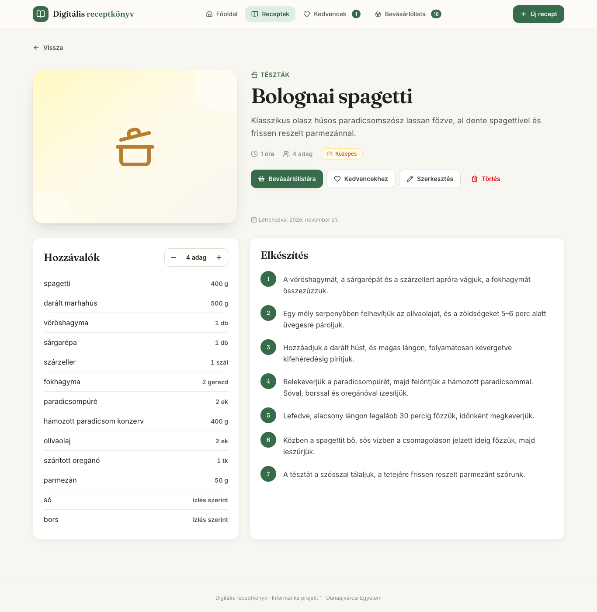
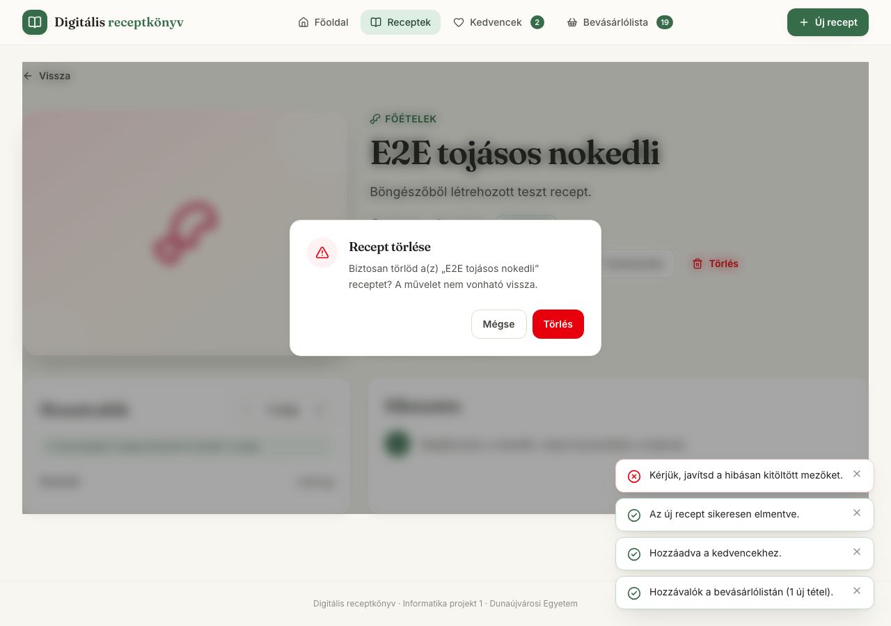
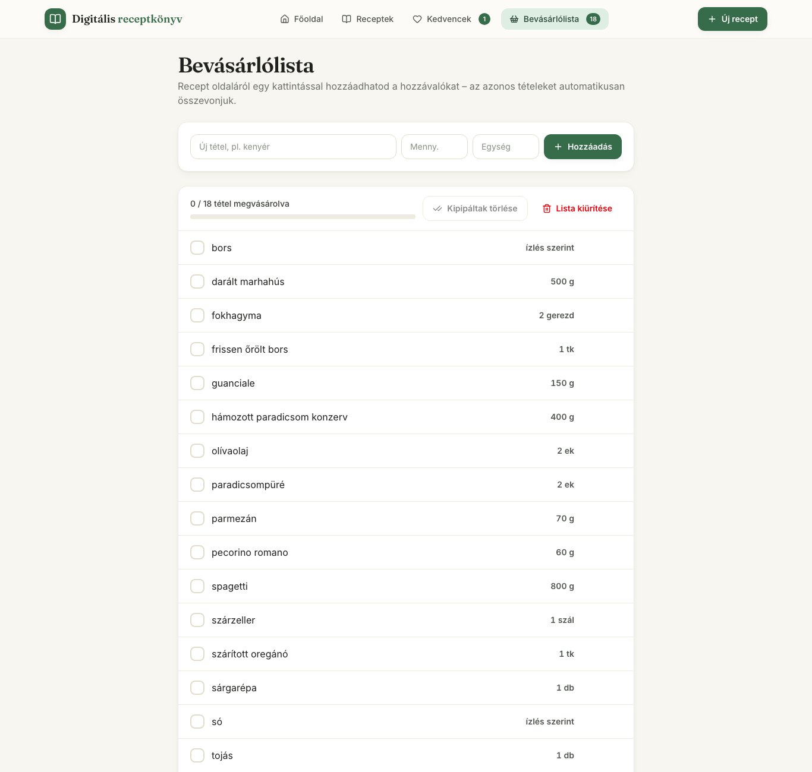

# Felhasználói útmutató

## Indítás

1. Telepítsd a Node.js-t (22.13 vagy újabb verzió).
2. A projekt mappájában futtasd: `npm install`, majd `npm run dev`.
3. Nyisd meg a böngészőben: <http://localhost:5173>.

Az első indításkor 20 mintarecept töltődik be automatikusan.

## A felület felépítése

- **Asztali nézet:** felül a navigáció (*Főoldal*, *Receptek*, *Kedvencek*, *Bevásárlólista*) és jobb oldalt az **Új recept** gomb. A kedvencek és a nyitott bevásárlólista-tételek száma zöld jelvényen látható.
- **Mobilnézet:** a navigáció alul, tab-sávként jelenik meg, középen egy kiemelt **+** gombbal (új recept).

## Főoldal


- **Kereső:** írj be egy receptnevet (pl. `gulyás`), majd nyomd meg a *Keresés* gombot.
- **Gyorskártyák:** összes recept, kedvencek, bevásárlólista. Kattintásra a megfelelő oldal nyílik meg.
- **Kategóriák:** egy kategóriára kattintva a receptlista arra a kategóriára szűrve jelenik meg.
- **Kiemelt receptek:** a „kiemelt” jelölésű receptek.

## Receptek böngészése és keresés

A *Receptek* oldalon:

| Mező | Használat |
| --- | --- |
| **Recept neve** | Név vagy leírás részlete. Nem számít a kis- és nagybetű, sem az ékezet (`gulyas` = `Gulyás`). |
| **Hozzávalók** | Egy vagy több hozzávaló vesszővel elválasztva, pl. `tojás, kolbász`. Csak azok a receptek jelennek meg, amelyekben **mindegyik** szerepel. |
| **Kategória** | Egy kategóriára szűr. |
| **Elkészítési idő** | Legfeljebb 15 perc, 30 perc, 1 óra vagy 2 óra. |
| **Nehézség** | Könnyű, közepes vagy nehéz. |
| **Rendezés** | Név, elkészítési idő vagy dátum szerint. A nyíl gomb a sorrendet váltja (növekvő vagy csökkenő). |

A feltételek együtt érvényesülnek, és a találatok száma megjelenik. A **Szűrők törlése** gomb mindent alaphelyzetbe állít. A szűrt nézet címe (URL-je) könyvjelzőzhető. Mobilon a szűrők a **Szűrők** gombbal nyithatók le.

## Recept megtekintése



- **Adagszám:** a −/+ gombokkal módosíthatod. A hozzávalók mennyisége arányosan átszámolódik (pl. 4 adagról 2-re: 400 g → 200 g).
- **Bevásárlólistára:** az összes hozzávalót a listára teszi, **az éppen beállított adagszámra** átszámítva.
- **Kedvencekhez / Kedvenc:** a recept kedvenc-állapotát váltja.
- **Szerkesztés:** megnyitja a szerkesztő űrlapot.
- **Törlés:** megerősítés után véglegesen törli a receptet.



## Új recept létrehozása

1. Kattints az **Új recept** gombra.
2. **Alapadatok:** név (kötelező), rövid leírás, kategória, elkészítési idő percben, adagszám, nehézség. Ha a *Kiemelt recept* be van jelölve, a recept megjelenik a főoldalon.
3. **Kép (opcionális):** adj meg egy `https://…` kezdetű kép-URL-t, vagy kattints a **Kép feltöltése** gombra. A feltöltött képet a program lekicsinyíti, és az adatbázisba menti, így internet nélkül is megjelenik. Kép nélkül a recept a kategóriájának megfelelő illusztrációt kapja.
4. **Hozzávalók:** név, mennyiség és mértékegység. A névnél a program a már ismert hozzávalókat javasolja.
   - Tört mennyiség tizedesvesszővel is megadható: `0,5`.
   - Ha a mennyiséget üresen hagyod, „ízlés szerint” jelenik meg (pl. só, bors).
   - Új sor: **Hozzávaló hozzáadása**; törlés: a kuka ikon.
5. **Elkészítési lépések:** minden lépés külön mezőbe kerül. A nyilakkal a sorrend módosítható.
6. Kattints a **Recept mentése** gombra.

Ha valamelyik mező hibás vagy hiányzik, piros keretet és magyar nyelvű hibaüzenetet kap (pl. „Az elkészítési idő legalább 1 perc.”), és az oldal az első hibához görget. Sikeres mentés után zöld értesítés jelenik meg, és megnyílik a recept oldala.

## Recept szerkesztése és törlése

- **Szerkesztés:** a receptoldalon a **Szerkesztés** gombbal. Az űrlap az aktuális adatokkal töltődik be, mentés után a módosítás dátuma frissül.
- **Törlés:** a **Törlés** gomb után a megerősítő ablakban újra a **Törlés** gombra kell kattintani. A *Mégse* gomb vagy az Esc billentyű megszakítja a műveletet.

## Kedvencek

- Jelölés: a receptkártya jobb felső sarkában vagy a receptoldalon a **szív** ikonra kattintva. A teli piros szív jelzi a kedvencet.
- A **Kedvencek** oldalon az összes kedvenc recept látható. A szívre kattintva a recept azonnal lekerül a listáról.
- A kedvencek az alkalmazás újraindítása után is megmaradnak.

## Bevásárlólista



### Tételek hozzáadása
- **Receptből:** a receptoldalon a **Bevásárlólistára** gombbal. Az értesítés megmutatja, hány új tétel került a listára, és hányat vont össze a program meglévő tételekkel.
- **Kézzel:** a lista tetején add meg a nevet, opcionálisan a mennyiséget és a mértékegységet, majd kattints a **Hozzáadás** gombra.

### Összevonási szabály
- Az **azonos nevű és azonos mértékegységű** tételek mennyisége összeadódik. Példa: bolognai spagetti (400 g spagetti) + carbonara (400 g spagetti) = **800 g spagetti** egy sorban.
- A **különböző mértékegységű** tételek külön sorban maradnak (pl. 2 ek pirospaprika és 1 tk pirospaprika), mert ezek nem adhatók össze helyesen.
- A már **kipipált** (megvett) tételhez a program nem ad hozzá újat, hanem új sort nyit, hogy egyértelmű legyen, mit kell még megvenni.
- A kis- és nagybetű és a felesleges szóköz nem számít; a gyakori mértékegység-írásmódok egységesítődnek (pl. „gramm” → „g”, „darab” → „db”).

### Tételek kezelése
- **Kipipálás:** kattints a tétel előtti négyzetre. A kipipált tételek áthúzva, a lista aljára kerülnek, a folyamatjelző pedig mutatja a haladást.
- **Szerkesztés (név, mennyiség, mértékegység):** a ceruza ikonnal. Asztali nézetben az ikon akkor jelenik meg, ha az egérmutató a sor fölött van.
- **Törlés:** a kuka ikonnal.
- **Kipipáltak törlése:** az összes megvett tételt eltávolítja (megerősítés után).
- **Lista kiürítése:** minden tételt töröl (megerősítés után).

Minden módosítás azonnal az adatbázisba kerül.

## Hibaüzenetek

- **„Nem sikerült kapcsolódni a szerverhez. Fut a backend?”:** a szerver nem fut. Indítsd újra az `npm run dev` paranccsal.
- **„Hiba történt a betöltés során”:** az **Újrapróbálás** gombbal a kérés megismételhető.

## Kezdőállapot visszaállítása

Bemutató előtt az adatbázis a mintaadatokkal visszaállítható (a saját receptek, a kedvencek és a lista törlődnek):

```bash
npm run db:reset
```
